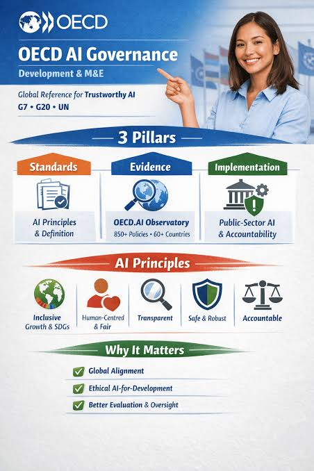
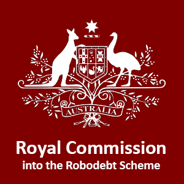
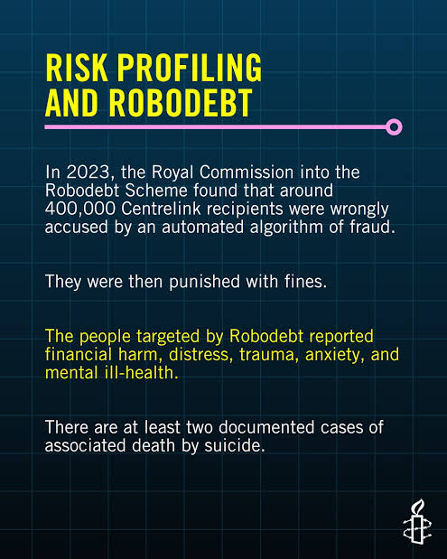
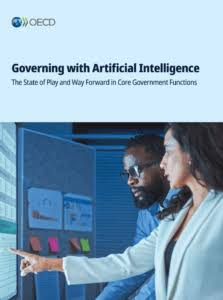

# E‑Portfolio 3 – Intellectual Property  
**Student:** Angus Algie
**Unit:** COIT11223 ICT Ethics and Governance in Society  
**Week 9 – Censorship and Government**  
---

# Artefact 1: Understanding ADM in Government

## Source
OECD AI in Government Overview

## Summary

This artefact is a report that explains how governments are using artificial intelligence and automated decision making systems in places such as public services, justice systems and policy development. The source identifies both opportunities and risks for implementing this highlighting that AI can improve efficiency and responsiveness while also introducing concerns like privacy, transparency and fairness.

## Reflection and Justification

Before reading this resource I had viewed ADM as a technical solution designed primarily to improve efficiency, yet after reading the sourceI learned that ADM systems influence decisions that directly affect citizens' lives. As well as their access to things like welfare, healthcare and public services. This broadened my understanding of technology and showed that technical decisions often become social and ethical decisions.

I selected this artefact because it provided a strong foundation for understanding ADM. It introduced the key concepts explored throughout the term and helped me recognise that ICT professionals must consider public impact in addition to technical performance. This learning connects strongly to the ACS principle of Primacy of the Public Interest because government technologies can significantly influence peoples lives.

---

# Artefact 2: The Robodebt Royal Commission

## Source
Royal Commission into the Robodebt Scheme

## Summary

The Robodebt Royal Commission investigated the use of an automated debt recovery system implemented by the Australian Government. The system generated debt noticed that  using income averaging methods were actually inaccurate.

## Reflection and Justification

This artefact changed my perspective on ADM as before studying Robodebt I had believed automated systems were more objective and accurate than humans, however after reading I learned that automation can amplify mistakes when incorrect assumptions are built into system design. Instead of reducing harm, the system contributed to widespread financial and emotional distress.

I selected this artefact because it is one of the most significant examples of ADM failure in Australia while also demonstrating why transparency and human oversight are essential. The case strongly relates to Kantian Ethics because individuals were not treated with appropriate respect and dignity. It also highlights the importance of the ACS principles of Public Interest and Quality of Life.

---

# Artefact 3: The Algorithm Behind Robodebt

## Source
University of Melbourne – The Flawed Algorithm at the Heart of Robodebt

## Summary

This article explains the technical operation of the Robodebt algorithm and also demonstrates how income averaging created inaccurate debt calculations. The article also further explores how a seemingly simple ADM system generated significant social consequences because of flawed assumptions and inadequate oversight.

## Reflection and Justification

This artefact helped me understand how technical design decisions can have significant societal impacts, as while studying this source I learned that a system can perform exactly as intended while still producing harmful outcomes. Whereas prior to this unit I often separated technical issues from ethical issues. 

I chose this artefact because it illustrates that ICT professionals have responsibilities beyond writing functional code. This artefact reinforced the importance of professional competence, accountability and ethical design practices.

---

# Artefact 4: Dutch Childcare Benefits Scandal

## Source
Politico – Dutch Childcare Benefits Scandal

## Summary

This artefact examines how Dutch tax authorities used algorithmic profiling to identify potential fraud. The article found that thousands of families were incorrectly identified as risks and experienced severe financial hardship. Due to this the scandal became an internationally recognised example of the dangers associated with poorly governed ADM systems.

## Reflection and Justification

Before exploring this case I had assumed that Australia's experience with Robodebt was unusual but reading this artefact reinforced this idea by showing that similar ADM failures have occurred internationally. I also learned that algorithms can reinforce existing inequalities and disproportionately affect vulnerable populations when fairness and transparency are not prioritised.

I selected this as one of my artefacts as it provided me with an international perspective on the issue and also demonstrated that ADM challenges are global issues. Furthermore, comparing the Netherlands and Australia helped me to understand the widespread importance of governance, accountability and ethical decision making in ICT.

---

# Artefact 5: Governing with Artificial Intelligence

## Source
OECD – Governing with Artificial Intelligence

## Summary

This report examined hundreds of government AI applications and discussed the governance mechanisms required for trustworthy ADM systems while also identifying the opportunities such as improved efficiency, fraud detection and service delivery associated with it. The report also made sure to talk about the negative impacts associated with the implementation of such applications.

## Reflection and Justification

Many discussions regarding ADM focus on failures but this artefact helped me develop a more balanced perspective as it also talked about the benefits. I learned that ADM can provide significant benefits when supported by strong governance frameworks. The problem is often not the technology itself but the way it is implemented and monitored.

I chose to use this artefact as it demonstrates that ethical ICT practice is not simply about avoiding implementation of technology due to the negative but instead its about developing the systems responsibly and ensuring that safeguards protect the public.This aligns closely with Rule Utilitarianism because properly governed ADM systems can create positive outcomes for large numbers of citizens.
---

# Artefact 6: Workshop Reflection

## Source
Workshop Notes and Discussion 

## Summary

During the workshop activities in this unit many students discussed algorithmic bias, transparency, accountability and the social impacts of automated decision making systems. The discussions also focused on fairness, government responsibility and the ethical obligations of ICT professionals.

## Reflection and Justification

The workshops were definitely the most valuable learning experience for me throughout the term as they allowed me to reflect on multiple viewpoints. Before participating in these workshops I generally trusted automated systems provided they met technical requirements but through discussion and case study analysis I became more aware of the social consequences that can emerge when ethical concerns are overlooked.

I selected this artefact because it demonstrates how my perspective changed throughout the unit. It shows how the discussions helped me connect theory with practice and how many of my assumptions regarding technology were challenged  while also demonstrating my engagement with the learning process and development as a future ICT professional.

---

# References

Heikkilä, M 2022, 'Dutch scandal serves as a warning for Europe over risks of using algorithms', *Politico*, 29 March, viewed 23 September 2026, <https://www.politico.eu/article/dutch-scandal-serves-as-a-warning-for-europe-over-risks-of-using-algorithms/>. 【1-b5b0a0】

Murray, T, Cheong, M & Paterson, J 2023, 'The flawed algorithm at the heart of Robodebt', *Pursuit*, University of Melbourne, 10 July, viewed 23 September 2026, <https://pursuit.unimelb.edu.au/articles/the-flawed-algorithm-at-the-heart-of-robodebt>. 【2-df0ca8】

OECD AI 2025, *AI in Government: Overview*, Organisation for Economic Co-operation and Development, viewed 23 September 2026, <https://oecd.ai/en/gov/issues/overview>. 【3-16bda2】

OECD AI 2025, *Governing with Artificial Intelligence: The state of play and way forward in core government functions*, Organisation for Economic Co-operation and Development, viewed 23 September 2026, <https://oecd.ai/en/ai-publications/governing-with-ai>. 【4-d931c6】

Royal Commission into the Robodebt Scheme 2023, *Report of the Royal Commission into the Robodebt Scheme*, Commonwealth of Australia, viewed 23 September 2026, <https://robodebt.royalcommission.gov.au/publications/report>. 【5-cf5ed8】

Royal Commissions 2023, *Robodebt Scheme*, Australian Government, viewed 23 September 2026, <https://www.royalcommission.gov.au/robodebt>. 【6-30656c】

Tosun Çobanoğlu, T 2026, 'Algorithms and the best interests of the child: Lessons from the Dutch childcare scandal', *Oxford Human Rights Hub*, 26 March, viewed 23 September 2026, <https://ohrh.law.ox.ac.uk/algorithms-and-the-best-interests-of-the-child-lessons-from-the-dutch-childcare-scandal/>. 【7-ecc4da】

Workshop discussion notes 2026, *COIT11223 ICT Ethics and Governance in Society ADM workshop activities and reflections*, CQUniversity, personal learning artefact.

